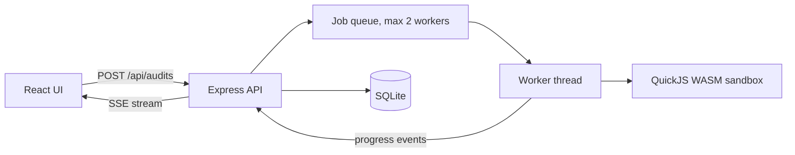

# BluffCheck

**AI writes code that looks right and is subtly wrong. BluffCheck proves it.**

   

Paste a JavaScript function and a trusted reference. BluffCheck runs both in a sandbox, hunts for inputs where they disagree, shrinks the failure to the smallest counterexample, probes how running time grows, and gives a trust score you can act on. Export the failing cases as ready-to-run Jest tests.


<table>
<tr><td></td><td></td></tr>
<tr><td align="center">Home</td><td align="center">Audit form with 7 seeded examples</td></tr>
</table>

## Measured results

Run on the 7 seeded example functions that ship with the app (written by the author, so this shows the detector works, not that it finds every bug in the wild):

| Function | Planted flaw | Verdict | Score |
|---|---|---|---|
| `binarySearch` | off-by-one, skips the last candidate | Wrong output (96 of 308 inputs failed) | 55 |
| `median` | two bugs | Wrong output and mutates its input | 40 |
| `dedupe` | hidden O(n^2) | Complexity bluff | 80 |
| `mergeIntervals` | edge case plus mutation | Wrong output and mutates its input | 43 |
| `isPalindrome` | wrong order of operations | Wrong output | 55 |
| `floorLog2` | non-termination | Does not terminate | 55 |
| `maxSubarray` (Kadane) | none, it is correct | No findings | 100 |

**6 of 6 buggy functions flagged, 0 false alarms on the correct one.** A typical audit takes 1 to 2 seconds. The non-terminating one takes about 18 seconds because every call hits its time limit.

## What it does

- **Sandboxed execution:** untrusted code runs in QuickJS compiled to WebAssembly with a 48 MB memory cap, a 256 KB stack cap and a 400 ms deadline per call, inside a worker thread per audit. At most 2 audits run at once, the queue is capped, and each job has a 90 s timeout. Tested against `while(true){}` and a `process`/`require` escape attempt.
- **Differential fuzzing** against your reference, plus property checks (never throws, does not mutate its input, deterministic).
- **Shrinker:** reduces a failing input to the smallest one that still fails, so the bug report is readable.
- **Complexity probe:** measures time at input sizes 250 to 8000 and fits a log-log slope to catch a function that claims O(n log n) but is O(n^2).
- **Trust score:** a critical finding caps the score at 55, and having no reference caps it at 85, because less evidence means less trust.
- **Output:** live progress over Server-Sent Events, Jest test export, Markdown report, audit history.



## Why a WebAssembly sandbox

Node's own docs say `vm` is not a security boundary. Running untrusted code needs a real isolation layer, so BluffCheck uses QuickJS in WebAssembly with hard memory, stack and time limits. Infinite loops are stopped by an interrupt handler.

## Honest limits

Fuzzing finds bugs but cannot prove a function correct. The complexity probe is an estimate and is noisy on small inputs. Only the five listed input shapes are supported. Scores are guidance, not a certificate.

## Stack

Node 22, Express 4, `node:sqlite`, `quickjs-emscripten`, React 18, Vite, Motion, Lenis. About 1,900 lines of application code.

## Run it

Needs Node 22.13 or newer (uses the built-in `node:sqlite`).

```bash
npm install
npm run dev                  # API on :3000, Vite dev server on :5173
npm test                     # 15 automated tests
npm run build && npm start   # production build, everything on :3000
```

## Deploy

Works on any host that runs a Node service or a Dockerfile (Render, Railway, Fly.io, a VPS).

| Setting | Value |
|---|---|
| Build / start | `npm install && npm run build` / `npm start`, or use the included `Dockerfile` |
| `DATA_DIR` | A folder on a **persistent disk** (the Dockerfile uses `/data`). Without one, data resets on each deploy |
| `TRUST_PROXY` | `1` behind a platform proxy, so rate limits see real client IPs |
| `PORT` | Set by most hosts automatically |

Put your contact email in `web/src/site.config.js` so the privacy and terms pages show it.

## Privacy by design

No accounts and no cookies. Each browser gets a random ID in localStorage, sent as a header, and every row is scoped to it. Data is deleted automatically after 30 days. Requests are rate limited and a strict Content-Security-Policy is set. The app has its own privacy and terms pages.
