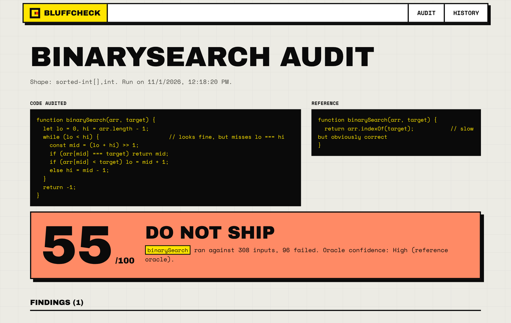
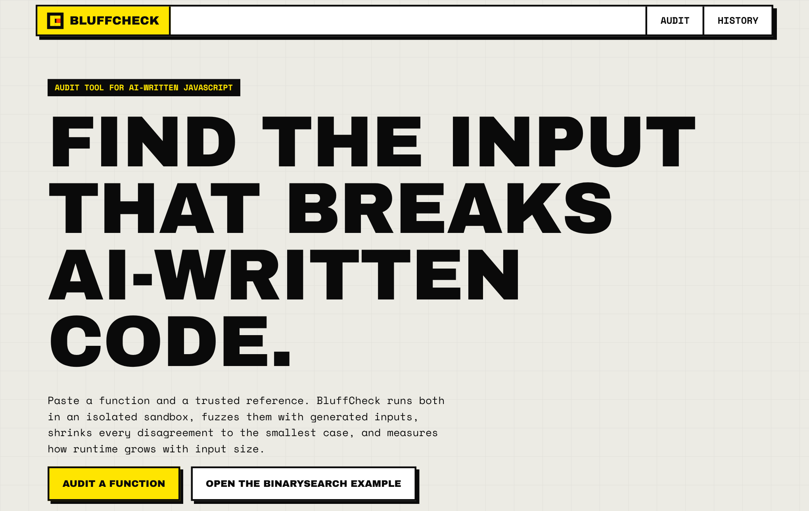
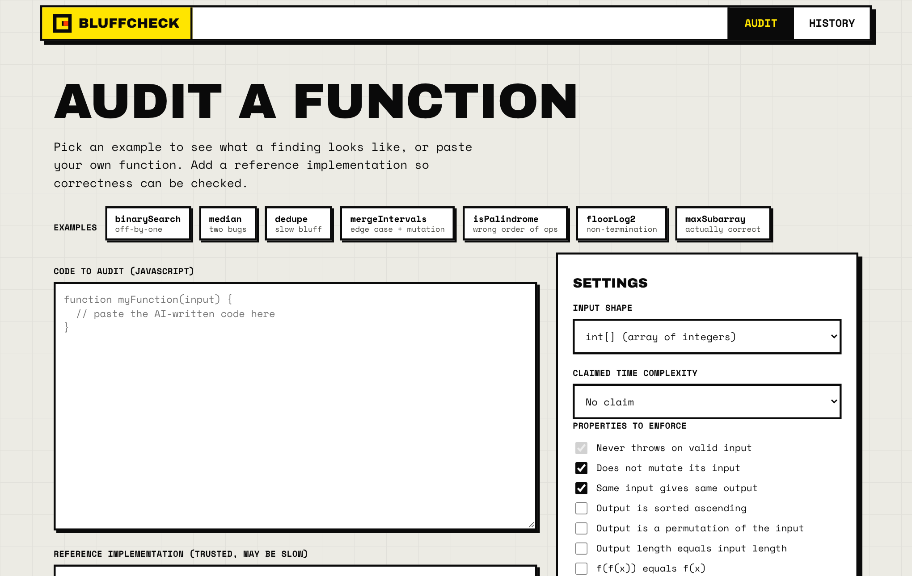
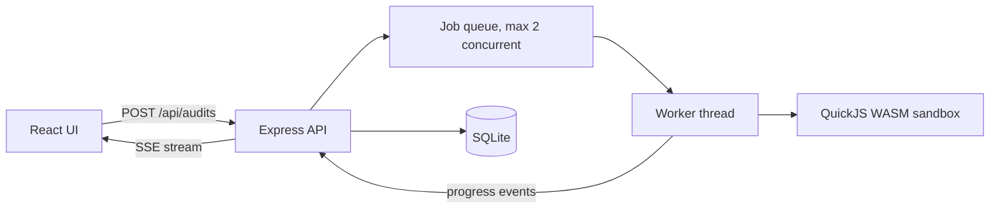

# BluffCheck

**AI writes code that looks right and is subtly wrong. BluffCheck proves it.**

   

**Live demo: https://bluffcheck.onrender.com** 

(free tier, the first load can take about 30 seconds to wake)

Paste a JavaScript function and a trusted reference. BluffCheck runs both in a sandbox, hunts for inputs where they disagree, shrinks the failure to the smallest counterexample, probes how running time grows, and gives a trust score you can act on. Export the failing cases as ready-to-run Jest tests.



<table>
<tr><td></td><td></td></tr>
<tr><td align="center">Home</td><td align="center">Audit form with 7 seeded examples</td></tr>
</table>

## The problem

AI assistants produce functions that pass a glance and a happy-path test, then fail on an empty array, a duplicate, a negative number or a large input. Reviewers cannot tell which confident answers are wrong without writing the tests themselves. BluffCheck turns "looks right" into evidence.

## Try it in 30 seconds

1. Open the [live demo](https://bluffcheck.onrender.com) and choose **Audit**.
2. Load the **binarySearch** example (an off-by-one that skips the last candidate) and run it.
3. Watch the stages stream in live, then read the verdict: score 55, "Do not ship", with the smallest failing input.
4. Download the **Jest tests** or the **Markdown report**.

## Measured results

Run on the 7 seeded example functions that ship with the app. The author wrote them, so this shows the detector works, not that it finds every bug in the wild.

| Function | Planted flaw | Verdict | Score |
|---|---|---|---|
| `binarySearch` | off-by-one, skips the last candidate | Wrong output (96 of 308 inputs failed) | 55 |
| `median` | two bugs | Wrong output and mutates its input | 40 |
| `dedupe` | hidden O(n^2) | Complexity bluff | 80 |
| `mergeIntervals` | edge case plus mutation | Wrong output and mutates its input | 43 |
| `isPalindrome` | wrong order of operations | Wrong output | 55 |
| `floorLog2` | non-termination | Does not terminate | 55 |
| `maxSubarray` (Kadane) | none, it is correct | No findings | 100 |

**6 of 6 buggy functions flagged and 0 false alarms on the correct one.** A typical audit takes 1 to 2 seconds. The non-terminating function takes about 18 seconds because every call runs into its time limit.

## What it does

- **Sandboxed execution.** Untrusted code runs in QuickJS compiled to WebAssembly with a 48 MB memory cap, a 256 KB stack cap and a 400 ms deadline per call, inside a worker thread per audit. At most 2 audits run at once, the queue is capped at 20 and each job times out at 90 seconds.
- **Differential fuzzing.** Your function is compared with the reference on generated inputs, including edge cases such as empty, single, duplicate, negative and large values.
- **Property checks.** Never throws on valid input, does not mutate its input, deterministic.
- **Shrinker.** Reduces a failing input to the smallest one that still fails, so the bug report is readable.
- **Complexity probe.** Times the function at sizes 250 to 8000 and fits a log-log slope to catch code that claims O(n log n) but is O(n^2).
- **Trust score.** A critical finding caps the score at 55. Having no reference caps it at 85, because less evidence means less trust.
- **Outputs.** Live progress over Server-Sent Events, Jest test export, Markdown report and audit history.

Supported input shapes: integer array, sorted integer array plus a target, single integer, string, and intervals.

## How it works



1. The UI posts the code, the reference, the input shape and the claimed complexity.
2. The API validates the input, stores the audit and queues it.
3. A worker thread builds two isolated sandboxes, one for your code and one for the reference.
4. It fuzzes, checks properties, shrinks any failure and probes complexity, emitting an event at each stage.
5. The score is computed and stored, and the UI renders the verdict.

## Why a WebAssembly sandbox

Node's own documentation says the `vm` module is not a security boundary. Running strangers' code on a server needs real isolation, so BluffCheck uses QuickJS compiled to WebAssembly. Memory, stack and time are limited from outside the guest, and an interrupt handler stops infinite loops. It was tested against `while(true){}` and an attempt to reach `process` and `require`, and neither escapes.

## API

| Method | Path | Purpose |
|---|---|---|
| GET | `/healthz` | Health check |
| GET | `/api/config` | Input shapes, properties, examples and limits |
| POST | `/api/audits` | Start an audit, returns an id |
| GET | `/api/audits/:id/stream` | Live progress (Server-Sent Events) |
| GET | `/api/audits` | List your audits |
| GET | `/api/audits/:id` | One audit with findings |
| DELETE | `/api/audits/:id` | Delete an audit |
| GET | `/api/audits/:id/tests.js` | Download Jest tests |
| GET | `/api/audits/:id/report.md` | Download Markdown report |

## Project structure

```
server/
  sandbox.js        QuickJS WASM sandbox, memory, stack and time limits
  core.js           input shapes, properties, fuzzing, shrinker, scoring, exporters
  examples.js       the 7 seeded examples
  audit-worker.js   worker thread that runs one audit
  db.js             SQLite storage and auto-purge
  index.js          Express routes, queue, rate limiting, security headers
web/                React 18 + Vite front end (brutalist UI, shared motion kit)
test/               15 automated tests (core logic and HTTP)
```

## Design decisions

- **Reference as oracle.** Differential testing needs no hand-written expected values, and the score says how much to trust the oracle.
- **Shrink before reporting.** A 40-element failing array tells you nothing; a 2-element one tells you the bug.
- **Caps in the score.** A single critical finding should not be averaged away by many passing checks.
- **SSE over WebSockets.** Progress is one-way, so a simple event stream is enough and works through proxies.

## Run it locally

Needs Node 22.13 or newer (uses the built-in `node:sqlite`).

```bash
npm install
npm run dev                  # API on :3000, Vite dev server on :5173
npm test                     # 15 automated tests
npm run build && npm start   # production build, everything on :3000
```


## Privacy by design

No accounts and no cookies. Each browser gets a random ID in localStorage, sent as a header, and every row is scoped to it. Audits are deleted automatically after 30 days. Requests are rate limited and a strict Content-Security-Policy is set. The app has its own privacy and terms pages.

## Honest limits

- Fuzzing finds bugs but cannot prove a function correct.
- The complexity probe is an estimate and is noisy on small inputs.
- Only the five input shapes above are supported, and only plain JavaScript functions.
- The score is guidance, not a certificate.

## Roadmap

- More input shapes (matrices, graphs, trees).
- Property-based generators the user can define.
- TypeScript and Python support.

## Stack

Node 22, Express 4, `node:sqlite`, `quickjs-emscripten`, worker threads, React 18, Vite, Motion, Lenis. About 1,900 lines of application code.

---

## 👩‍💻 Author

**Subhalaxmi Panda**  
Software Developer | AI/ML Enthusiast | Full-Stack Developer

I enjoy building practical software solutions, exploring emerging technologies, and turning ideas into scalable, user-focused applications.

### Connect with Me

<p align="left">
  <a href="https://github.com/SubhuPanda21">
    
  </a>
  <a href="https://www.linkedin.com/in/subhalaxmipanda">
    
  </a>
</p>

---

<p align="center">
  <b>Designed & Developed by Subhalaxmi Panda</b>
  <br>
  Building. Learning. Innovating.
</p>
